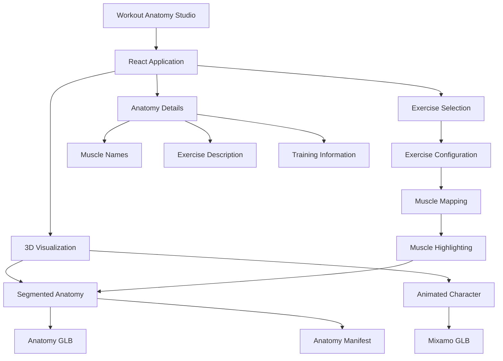

# Workout Anatomy Studio

### Interactive 3D Human Anatomy & Exercise Visualization Platform

[](https://github.com/AlokDubey5905/workout-anatomy-studio)


**Repository:** https://github.com/AlokDubey5905/workout-anatomy-studio

**Project status:** Active Development  
**Current local milestone:** Version 0.5 — Segmented Anatomy Integration  
**Platform:** Windows 10/11  
**Application type:** Web-based 3D application

---

# 1. Project Overview

Workout Anatomy Studio is a web-based 3D anatomy and exercise visualization platform designed to demonstrate how human muscles work during different physical exercises.

The primary objective is to develop an anatomically detailed, interactive 3D human model that can:

- Demonstrate exercises through realistic human animations.
- Identify individual muscles involved in an exercise.
- Highlight primary and secondary muscle groups.
- Allow users to rotate, zoom and inspect the human body.
- Switch between anterior (front) and posterior (back) anatomical views.
- Display detailed information about individual muscles.
- Explain exercise movements and muscle activation.
- Eventually generate educational-quality exercise animation videos.

The project is being developed using React, TypeScript, Three.js and Blender.

Instead of relying on static exercise illustrations, the application will use interactive 3D models and skeletal animations to explain human anatomy.

## 1.1 Final Vision

The final application should combine two complementary 3D systems:

**A. Animated Exercise Demonstration Model**

A realistic muscular human character that performs exercises such as:

- Bicep Curl
- Squat
- Push Up
- Shoulder Press
- Bench Press
- Lat Pulldown
- Deadlift

**B. Anatomical Muscle Visualization Model**

A separate anatomically detailed human model with individually selectable muscles.

When a user selects an exercise, the application should:

1. Display the exercise demonstration.
2. Identify the primary muscles involved.
3. Highlight the primary muscles on the anatomical model.
4. Highlight secondary muscles using a different intensity or color.
5. Display muscle names and anatomical information.
6. Explain the movement and the muscles involved.

The two models should eventually work together to provide an educational experience.

---

# 2. Target Application Design

The target design is a premium, dark-themed anatomical visualization interface.

### Reference design

The intended anatomical appearance is a detailed muscular human model with distinguishable muscle structures, realistic proportions and a clean presentation.

Reference resources:

- https://sirwan.info/anatomy-atlas/
- https://github.com/SirwanAfifi/anatomy-atlas

### Target visual requirements

| Component | Expected behavior |
|---|---|
| Human model | Realistic muscular anatomy |
| Camera | Full-body framing |
| Background | Dark navy |
| Lighting | Soft studio lighting |
| Floor | Subtle reference grid |
| Muscle highlighting | Red primary muscle highlight |
| Secondary muscles | Orange or lighter red |
| Normal muscles | Original anatomical materials |
| Interaction | Rotate, zoom and inspect |
| Anatomy panel | Muscle names and information |

### Planned screenshots and reference images

Store project screenshots in `docs/images/` and use these filenames:

- `target-anatomy-reference.png` — Desired anatomical appearance.
- `current-v0.5-anatomy.png` — Current implementation.
- `mixamo-animation-test.png` — Animation validation.
- `blender-rig-validation.png` — Blender rig and animation setup.
- `target-application-ui.png` — Final application design.

Embed them in this README using:

```markdown


```

These screenshot files need to be added to the repository; the references were captured during development but are not yet committed as documentation images.

---

# 3. Technology Stack

## 3.1 Frontend

| Technology | Purpose |
|---|---|
| React | Component-based application development |
| TypeScript | Type safety and maintainability |
| Vite | Development server and build tooling |
| CSS | Application layout and styling |

## 3.2 3D Rendering

| Technology | Purpose |
|---|---|
| Three.js | 3D rendering engine |
| React Three Fiber | React renderer for Three.js |
| @react-three/drei | Helpers for GLTF loading, controls and animations |
| GLB / glTF | 3D model and animation interchange format |

## 3.3 3D Modelling and Animation

| Tool | Purpose |
|---|---|
| Blender 5.3 | Model inspection, rigging and animation preparation |
| Adobe Mixamo | Character rigging and skeletal animations |
| Sketchfab | Initial muscular human model sourcing |

## 3.4 Development Tools

- Visual Studio Code
- Node.js
- npm
- Git
- GitHub
- Microsoft Edge / Chrome Developer Tools

## 3.5 Current Dependencies

The published repository's `package.json` specifies:

```json
{
  "dependencies": {
    "@react-three/drei": "^10.7.9",
    "@react-three/fiber": "^9.8.2",
    "react": "^19.3.1",
    "react-dom": "^19.3.1",
    "three": "^0.187.0",
    "zustand": "^5.1.0"
  },
  "devDependencies": {
    "@types/node": "^24.19.2",
    "@types/react": "^19.3.0",
    "@types/react-dom": "^19.3.0",
    "@types/three": "^0.187.0",
    "@vitejs/plugin-react": "^6.1.2",
    "oxlint": "^1.90.0",
    "typescript": "~7.0.2",
    "vite": "^8.3.6"
  }
}
```

Actual installed versions should be confirmed from the local `package-lock.json` and development environment.

---

# 4. Development History

This section documents the work completed so far and the decisions made during development.

## Version 0.1 — Initial Application Setup

### Objective

Create a working React application with a 3D visualization area.

### Work completed

- Created a React + TypeScript + Vite application.
- Created the initial application layout.
- Implemented the exercise selection sidebar.
- Created the anatomy details panel.
- Integrated React Three Fiber.
- Added a basic Three.js scene.
- Added lighting and grid helpers.
- Created an initial procedural human placeholder using Three.js geometries.

### Initial exercise options

1. Bicep Curl
2. Squat
3. Push Up
4. Shoulder Press

### Initial architecture

```text
src/
├── App.tsx
├── App.css
├── index.css
├── main.tsx
│
└── components/
    ├── AnatomyViewer.tsx
    └── AnatomicalHuman.tsx
```

The initial placeholder was built using spheres, capsules and cylinders.

It was useful for validating the rendering pipeline, but it did not provide realistic human anatomy.

Decision: replace the procedural placeholder with an actual 3D muscular human model.

---

## Version 0.2 — Real Human Model Integration

### Objective

Replace the primitive placeholder with a realistic muscular human model.

### Tool used

Sketchfab:

https://sketchfab.com/

### Model selected

Male Base Muscular Anatomy by CharacterZone.

Model reference:

https://sketchfab.com/3d-models/male-base-muscular-anatomy-0954aa04666d45aab9633009318f7b66

### Work completed

- Sourced and downloaded the muscular human model.
- Imported the model into the project.
- Integrated GLB loading through `useGLTF`.
- Inspected the model using Three.js.
- Identified detached eye meshes.
- Investigated mesh names and model dimensions.
- Adjusted model scaling and positioning.

The model initially appeared extremely small because its original dimensions differed from the camera and scene assumptions.

A normalization strategy was introduced to make the model easier to display.

---

## Version 0.3 — Mixamo Rigging and Animation

### Objective

Make the human character move rather than remain in a static T-pose.

### Tool used

Adobe Mixamo:

https://www.mixamo.com/

### Workflow followed

1. Downloaded the muscular human character.
2. Uploaded the character to Mixamo.
3. Completed automatic character rigging.
4. Selected an Idle animation.
5. Downloaded the animated FBX.
6. Imported the FBX into Blender.
7. Inspected the armature and animation.
8. Tested playback in Blender.
9. Exported the animation to GLB.
10. Loaded the animated GLB into the React application.

### Blender files created

```text
blender/
├── anatomy-model.blend
├── muscular-human-idle.blend
├── muscular-human.fbx
│
└── exports/
    ├── muscular-human-idle.fbx
    └── muscular-human-rigged.fbx
```

### Animation validation

The following was verified during development:

- Character rig is present.
- Idle animation is available.
- Animation plays correctly in Blender.
- Browser animation runs continuously.
- The character is no longer permanently stuck in T-pose.

The idle animation was successfully integrated using Three.js animation actions.

---

## Version 0.4 — Camera and UI Improvements

### Objective

Improve the presentation of the 3D model.

### Problems encountered

- Model was too small.
- Model was not centered.
- Camera target was incorrect.
- The character was partially outside the visible area.
- Floor positioning was inconsistent.

### Improvements

- Adjusted camera position.
- Adjusted field of view.
- Updated OrbitControls target.
- Adjusted model normalization.
- Improved grid placement.
- Improved overall model framing.
- Updated exercise information panel.

### Camera implementation

The viewer uses:

```tsx
<OrbitControls
    target={[0, 1.4, 0]}
    enableDamping
    dampingFactor={0.05}
    minDistance={2.5}
    maxDistance={8}
/>
```

The exact target and camera distance must be recalculated when the anatomical model changes.

---

## Version 0.5 — Segmented Anatomy Integration

### Objective

Introduce a separate anatomical model containing individually identifiable muscle structures.

The animated Mixamo character and anatomical model are intended to remain separate.

### Why a second model?

The original Mixamo character is suitable for demonstrating movements.

However, it does not provide a reliable collection of independently selectable anatomical muscle meshes.

A segmented anatomy model is required to explain which muscles are involved in each exercise.

### Selected anatomical asset

Anatomy Atlas:

https://github.com/SirwanAfifi/anatomy-atlas

Website:

https://sirwan.info/anatomy-atlas/

The project provides a human anatomy asset with 126 muscle structures and a manifest describing the anatomical regions.

### Files downloaded

```text
public/
└── models/
    └── muscle-anatomy/
        ├── male.glb
        ├── manifest.json
        ├── NOTICE.txt
        ├── LICENSE.txt
        ├── UPSTREAM-LICENSE.txt
        └── CC-BY-SA-4.0.txt
```

These files were downloaded and placed in the local project directory.

At the time of this documentation, these segmented anatomy assets have not yet been verified in the public GitHub repository.

### Initial implementation

A new React component was introduced locally:

```text
src/components/
├── AnatomyViewer.tsx
├── AnatomicalHuman.tsx
└── SegmentedAnatomy.tsx
```

The intended implementation uses:

- `useGLTF` to load the GLB.
- `useLoader` to load the JSON manifest.
- Three.js scene traversal to inspect meshes.
- Cloned materials to avoid modifying cached source materials.
- Emissive material properties to highlight selected muscles.
- React state to control the selected exercise.

### Initial exercise-to-muscle mapping

| Exercise | Primary muscle | Secondary muscles |
|---|---|---|
| Bicep Curl | Biceps Brachii | Brachialis, Brachioradialis |
| Squat | Quadriceps | Gluteus Maximus, Hamstrings |
| Push Up | Pectoralis Major | Triceps, Anterior Deltoids |
| Shoulder Press | Deltoids | Triceps, Trapezius |

These mappings are initial educational mappings and must be validated before being treated as final anatomical data.

### Current validation result

The anatomical model successfully appeared in the browser.

However, the visual result is not yet at the required quality.

The browser console reported:

```text
ANATOMY MODEL DIAGNOSTICS

expectedMeshes: 126
matchedMeshes: 20
missingMeshes: 106
```

This indicates an incomplete match between the mesh names in the GLB and the names declared in the manifest.

### Current blockers

1. Manifest-to-GLB mesh mapping is incomplete.
2. Anatomical model appearance is not sufficiently clean.
3. Current camera framing crops parts of the figure.
4. Some facial and material details need inspection.
5. Muscle highlighting has not been fully validated.
6. A React unmount error has been observed during development.
7. Three.js clock deprecation warning needs cleanup.

**Version 0.5 is therefore in progress, not complete.**

---

# 5. Current Application Architecture

The intended architecture separates the exercise demonstration system from the anatomy visualization system.



## 5.1 Animated Character System

Responsible for:

- Loading the Mixamo character.
- Playing idle animations.
- Playing exercise animations.
- Controlling animation playback.
- Handling animation transitions.

Main asset:

```text
public/models/muscular-human-idle.glb
```

Main component:

```text
src/components/AnatomicalHuman.tsx
```

## 5.2 Segmented Anatomy System

Responsible for:

- Loading the anatomical GLB.
- Identifying individual meshes.
- Reading the manifest.
- Highlighting selected muscles.
- Handling muscle selection.
- Displaying anatomical information.

Main assets:

```text
public/models/muscle-anatomy/male.glb

public/models/muscle-anatomy/manifest.json
```

Main component:

```text
src/components/SegmentedAnatomy.tsx
```

## 5.3 Exercise Configuration

Responsible for mapping exercises to muscles.

Example:

```typescript
const exercises = [
    {
        id: "bicep",
        name: "Bicep Curl",
        muscles: ["biceps", "forearms"]
    },
    {
        id: "squat",
        name: "Squat",
        muscles: ["quads", "glutes", "hamstrings"]
    },
    {
        id: "pushup",
        name: "Push Up",
        muscles: [
            "chest",
            "triceps",
            "front-shoulders"
        ]
    },
    {
        id: "shoulder",
        name: "Shoulder Press",
        muscles: [
            "front-shoulders",
            "triceps",
            "traps"
        ]
    }
];
```

The actual mapping must use verified manifest identifiers.

---

# 6. Local Development Environment

The project is being developed on a Windows PC.

## 6.1 Prerequisites

Install:

1. Node.js (LTS).
2. npm.
3. Visual Studio Code.
4. Blender.
5. Git.
6. A modern browser with WebGL support.

Useful download links:

Node.js: https://nodejs.org/

Visual Studio Code: https://code.visualstudio.com/

Blender: https://www.blender.org/download/

Git: https://git-scm.com/downloads

## 6.2 Clone the repository

```bash
git clone https://github.com/AlokDubey5905/workout-anatomy-studio.git

cd workout-anatomy-studio
```

## 6.3 Install dependencies

```bash
npm install
```

## 6.4 Start development server

```bash
npm run dev
```

Open:

```text
http://localhost:5174
```

Vite may select another available port if 5174 is already occupied.

## 6.5 Production build

```bash
npm run build
```

## 6.6 Linting

```bash
npm run lint
```

## 6.7 Preview production build

```bash
npm run preview
```

---

# 7. Project Directory Structure

The current repository and intended local development structure are:

```text
workout-anatomy-studio/
│
├── blender/
│   ├── anatomy-model.blend
│   ├── anatomy-model.blend1
│   ├── muscular-human-idle.blend
│   ├── muscular-human.fbx
│   │
│   └── exports/
│       ├── muscular-human-idle.fbx
│       └── muscular-human-rigged.fbx
│
├── public/
│   ├── favicon.svg
│   ├── icons.svg
│   │
│   └── models/
│       ├── anatomy-human.glb
│       ├── muscular-human-idle.glb
│       │
│       └── muscle-anatomy/
│           ├── male.glb
│           ├── manifest.json
│           ├── NOTICE.txt
│           ├── LICENSE.txt
│           ├── UPSTREAM-LICENSE.txt
│           └── CC-BY-SA-4.0.txt
│
├── src/
│   ├── App.tsx
│   ├── App.css
│   ├── index.css
│   ├── main.tsx
│   │
│   ├── assets/
│   │
│   └── components/
│       ├── AnatomyViewer.tsx
│       ├── AnatomicalHuman.tsx
│       └── SegmentedAnatomy.tsx
│
├── docs/
│   └── images/
│
├── index.html
├── package.json
├── package-lock.json
├── tsconfig.json
├── tsconfig.app.json
├── tsconfig.node.json
├── vite.config.ts
├── .gitignore
└── README.md
```

Note: This is the target working structure. Some files, particularly `SegmentedAnatomy.tsx` and `public/models/muscle-anatomy/`, are currently local development assets and may not yet exist in the public repository.

---

# 8. 3D Asset Pipeline

## 8.1 Sketchfab Model

Initial model source:

https://sketchfab.com/3d-models/male-base-muscular-anatomy-0954aa04666d45aab9633009318f7b66

Creator: CharacterZone.

Purpose:

- Initial muscular human model.
- Character preparation.
- Rigging and animation workflow.

The model's original license and creator attribution must be retained when distributing the asset.

## 8.2 Mixamo

Website:

https://www.mixamo.com/

Purpose:

- Automatic skeletal rigging.
- Character animation.
- Idle animation.
- Future exercise animations.

Expected future animation assets:

```text
public/models/animations/
├── idle.glb
├── bicep-curl.glb
├── squat.glb
├── push-up.glb
└── shoulder-press.glb
```

These are planned asset names, not files currently confirmed to exist.

## 8.3 Blender

Website:

https://www.blender.org/

Blender is used for:

- Importing FBX models.
- Inspecting armatures.
- Checking skeletal animation.
- Validating playback.
- Preparing GLB exports.
- Correcting model orientation and scale.
- Future animation refinement.

The current Mixamo idle animation was successfully tested in Blender.

## 8.4 Anatomy Atlas

Repository:

https://github.com/SirwanAfifi/anatomy-atlas

Website:

https://sirwan.info/anatomy-atlas/

Purpose:

- Segmented human anatomical model.
- Muscle structure identification.
- Anatomical mesh metadata.
- Reference for muscle visualization.

The downloaded asset includes:

```text
male.glb
manifest.json
NOTICE.txt
LICENSE.txt
UPSTREAM-LICENSE.txt
CC-BY-SA-4.0.txt
```

Preserve the original attribution and licensing information. Verify all upstream licensing conditions before redistributing or modifying these assets.

---

# 9. Planned Feature Development

The following features define the final product.

## Version 0.6 — Interactive Muscle Selection

Objectives:

- Fix manifest-to-mesh mapping.
- Make individual muscle meshes selectable.
- Click a muscle to inspect it.
- Display its anatomical name.
- Show muscle group and side.
- Restore original material when deselected.

Expected interaction:

```text
User clicks Biceps Brachii
        |
        v
Identify selected mesh
        |
        v
Highlight muscle
        |
        v
Display anatomical details
```

## Version 0.7 — Front and Back Views

Objectives:

- Anterior view.
- Posterior view.
- Left-side view.
- Right-side view.
- Smooth camera transitions.
- Proper full-body framing.

## Version 0.8 — Exercise Animation Integration

Objectives:

- Introduce exercise-specific Mixamo animations.
- Load the correct animation when an exercise is selected.
- Control playback.
- Add pause and replay.
- Synchronize the exercise demonstration with muscle highlighting.

## Version 0.9 — Muscle Activation Visualization

Objectives:

- Primary muscle highlighting.
- Secondary muscle highlighting.
- Different intensity levels.
- Anatomical labels.
- Muscle activation explanation.

Suggested visual convention:

| Category | Color |
|---|---|
| Primary muscles | Red |
| Secondary muscles | Orange |
| Other muscles | Original material |
| Selected individual muscle | Bright highlight |

## Version 1.0 — Educational Video Studio

Objectives:

- Exercise selection.
- Camera positioning.
- Animation playback controls.
- Muscle highlight controls.
- Front/back camera selection.
- Video recording or rendering.
- Export educational exercise animations.

The final system should support the creation of educational workout videos without requiring manual video editing for every exercise.

---

# 10. Final Product Architecture

The long-term application should be structured into the following modules:

```text
src/
│
├── components/
│   ├── layout/
│   ├── exercise/
│   ├── anatomy/
│   ├── viewer/
│   └── controls/
│
├── features/
│   ├── exercise-library/
│   ├── muscle-mapping/
│   ├── animation-engine/
│   ├── anatomy-selection/
│   └── video-export/
│
├── data/
│   ├── exercises.ts
│   ├── muscles.ts
│   └── anatomy-manifest.ts
│
├── hooks/
│   ├── useAnatomy.ts
│   ├── useAnimation.ts
│   └── useExercise.ts
│
├── services/
│   ├── model-loader.ts
│   ├── animation-service.ts
│   └── video-export-service.ts
│
├── App.tsx
├── App.css
├── index.css
└── main.tsx
```

This is the proposed future architecture, not the current committed file structure.

---

# 11. Known Issues and Technical Considerations

The following issues must be resolved before considering the current implementation stable.

### 11.1 Manifest and GLB mesh mismatch

Observed output:

```text
expectedMeshes: 126
matchedMeshes: 20
missingMeshes: 106
```

Required investigation:

- Inspect actual GLB mesh names.
- Inspect manifest mesh identifiers.
- Determine whether meshes are grouped or renamed.
- Check scene hierarchy.
- Build a verified mapping between manifest regions and GLB meshes.

Do not assume that manifest names and Three.js object names are identical.

### 11.2 Anatomical model appearance

Current problems:

- Incomplete-looking facial region.
- Model is not consistently framed.
- Some body parts are cropped.
- Overall anatomical presentation is not yet clean enough.

Required improvements:

- Correct normalization.
- Calculate model bounding box.
- Center the model.
- Fit camera to the full body.
- Verify model materials.
- Improve studio lighting.
- Inspect geometry and textures.

### 11.3 React rendering error

Observed error:

```text
Attempted to synchronously unmount a root
while React was already rendering.
```

A subsequent error reported:

```text
NotFoundError:
Failed to execute 'removeChild' on 'Node'
```

Investigate:

- React Three Fiber lifecycle.
- Suspense behavior.
- HTML portals.
- Duplicate Canvas roots.
- Component cleanup.
- Strict Mode development behavior.

Do not disable React Strict Mode simply to hide the problem.

### 11.4 Three.js deprecation warning

Observed warning:

```text
THREE.Clock: This module has been deprecated.
Please use THREE.Timer instead.
```

Inspect the source of the warning and update the relevant dependency or implementation.

### 11.5 Blackbox CORS errors

Observed requests:

```text
https://www.useblackbox.io/tlm
```

These requests fail due to CORS restrictions.

They appear to originate from an external browser extension or injected script rather than the Three.js model-loading pipeline.

They should be investigated separately and should not be confused with GLB loading errors.

---

# 12. Important Development Guidelines

Any developer continuing this project should follow these guidelines.

1. Do not remove the working Mixamo animation implementation while improving anatomical visualization.
2. Keep the animated demonstration character separate from the segmented anatomical model.
3. Avoid hardcoding mesh names without inspecting the GLB.
4. Keep original GLB materials available for restoring normal appearance.
5. Use cloned materials when implementing independent muscle highlighting.
6. Always verify model bounding boxes before setting camera positions.
7. Avoid repeatedly loading large GLB assets.
8. Preserve original model attribution and license files.
9. Test each exercise independently.
10. Keep the application functional after every milestone.
11. Do not mark a feature complete without browser validation.
12. Avoid committing large temporary Blender backup files unnecessarily.

For large binary model assets, evaluate Git LFS or an appropriate asset storage strategy.

---

# 13. Important Reference URLs

| Resource | URL |
|---|---|
| Project GitHub | https://github.com/AlokDubey5905/workout-anatomy-studio |
| Three.js | https://threejs.org/ |
| React Three Fiber | https://r3f.docs.pmnd.rs/ |
| React Three Drei | https://github.com/pmndrs/drei |
| React documentation | https://react.dev/ |
| TypeScript | https://www.typescriptlang.org/ |
| Vite | https://vite.dev/ |
| Blender | https://www.blender.org/ |
| Mixamo | https://www.mixamo.com/ |
| Sketchfab | https://sketchfab.com/ |
| Anatomy Atlas | https://github.com/SirwanAfifi/anatomy-atlas |
| Anatomy Atlas Website | https://sirwan.info/anatomy-atlas/ |
| GLTF specification | https://www.khronos.org/gltf/ |
| GLTF loader documentation | https://threejs.org/docs/#examples/en/loaders/GLTFLoader |
| OrbitControls documentation | https://threejs.org/docs/#examples/en/controls/OrbitControls |

---

# 14. Current Project Status

| Area | Status |
|---|---|
| React application setup | Completed |
| Initial UI | Completed |
| Exercise selection interface | Implemented |
| Initial human placeholder | Replaced locally |
| Muscular GLB integration | Completed locally |
| Mixamo character rigging | Completed |
| Idle animation in Blender | Tested successfully |
| Idle animation in browser | Verified |
| Camera improvements | Implemented locally |
| Exercise information panel | Implemented locally |
| Segmented anatomy asset download | Completed locally |
| Segmented anatomy loading | Working locally, visual refinement required |
| Manifest mapping | Incomplete |
| Individual muscle highlighting | Not validated |
| Front/back anatomy controls | Pending |
| Exercise-specific animations | Pending |
| Muscle activation visualization | Pending |
| Video export | Pending |

**Overall status: Active development.**

The application has progressed beyond a basic Three.js prototype. It now has a functioning 3D rendering foundation, a working animated character and an initial segmented anatomy integration.

However, the anatomy mapping and final visual quality remain the immediate priorities.

---

# 15. Instructions for the Next Developer

If you are picking up this project, do not immediately start building new features.

First, understand the existing model pipeline and resolve the current Version 0.5 issues.

Recommended sequence:

1. Clone the repository.
2. Install dependencies.
3. Run the application.
4. Inspect the existing GLB assets.
5. Confirm the local segmented anatomy files are available.
6. Inspect actual mesh names using Three.js.
7. Compare actual mesh names with `manifest.json`.
8. Correct the mesh mapping.
9. Fix the model framing and visual appearance.
10. Verify individual muscle highlighting.
11. Proceed to interactive muscle selection.

The immediate objective is to achieve a clean, anatomically detailed full-body model with reliable individual muscle identification.

Do not move to advanced animation synchronization until the anatomy system is reliable.

---

# 16. Project Goal

Workout Anatomy Studio aims to become an educational 3D workout and anatomy visualization platform.

The long-term vision is to make exercise anatomy understandable through interactive 3D visualization rather than relying on static images or generic workout animations.

A user should be able to select an exercise, watch the movement, rotate the human body, inspect the muscles involved and understand how the exercise works.

The final product should also provide a foundation for producing high-quality educational workout videos for YouTube and other content platforms.

**Build the anatomy. Understand the movement. Visualize the muscles.**

---

## Project Repository

**Workout Anatomy Studio**

https://github.com/AlokDubey5905/workout-anatomy-studio

## Project Overview


## Target Design vs Current Progress


Maintained by the project owner.
